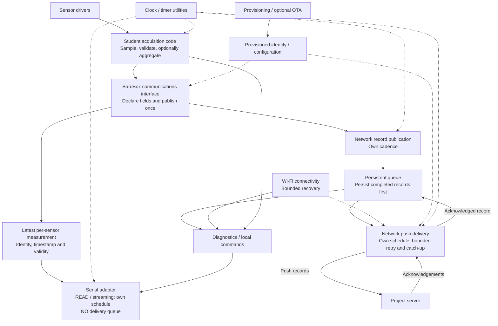
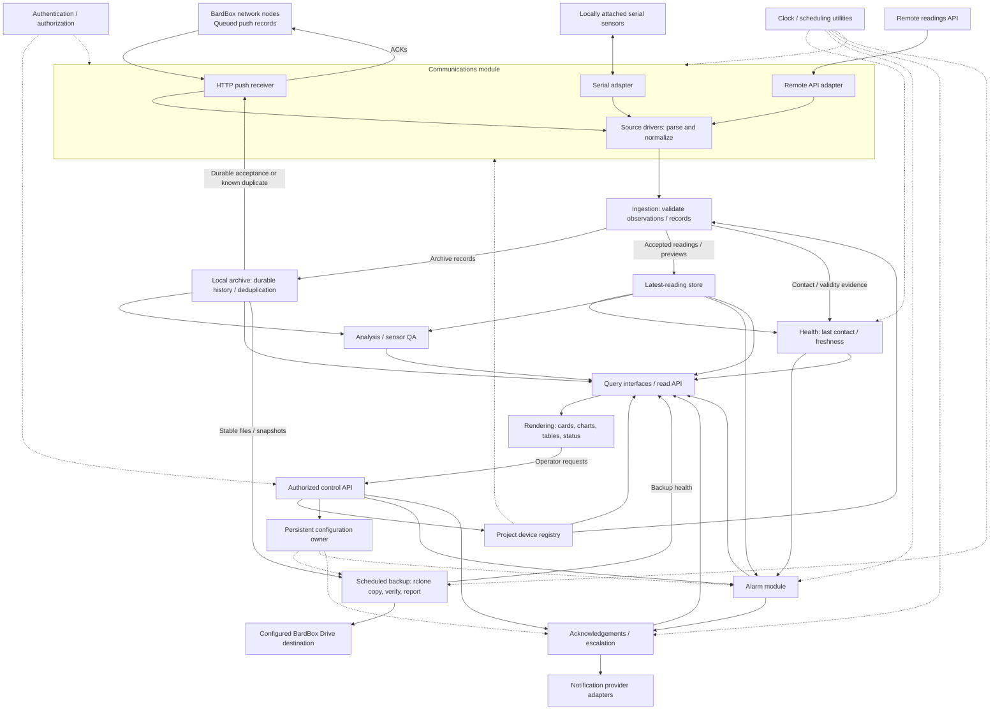
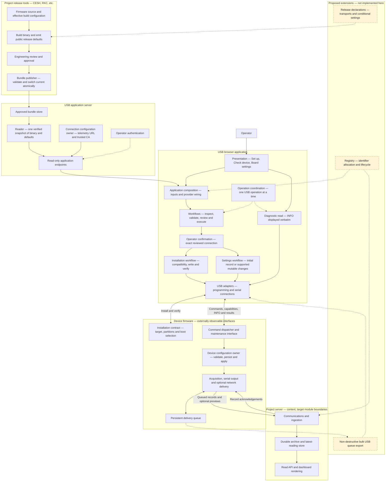

# BardBox Architecture Map

Status: **proposed target design**, recorded October 16, 2026 at Kornelis's request.
This is the single maintained source for all three diagrams below, not a claim
that their modules are implemented or deployed. Published contracts remain
authoritative. Review and merge are separate from implementation and deployment.

## Diagram index and ownership

| Diagram / contract | Maintained owner and source | Status |
| --- | --- | --- |
| Student-facing firmware template | [Node drawing below](#node-firmware-template) | Target design |
| Project server template | [Server drawing below](#project-server-template) | Target design |
| USB flasher implementation and external boundaries | [USB flasher drawing below](#usb-flasher) | Current implementation map with proposed extensions labelled |
| Firmware lifecycle, layouts and documentation map | [Firmware blueprint](firmware-blueprint.md) | Proposal |
| Student serial/base interface | [Serial/base API](firmware-base-and-serial-api.md) | Proposal; exact names and compatibility unresolved |
| Persistent delivery queue | [Buffer API](firmware-buffer-api.md) | Proposal |
| USB provisioning contract | [USB flashing and provisioning](usb-provisioning-standard.md) | Proposal |
| OTA lifecycle | [Existing OTA draft at its review head](https://github.com/bardphysicslab/bardbox/blob/7b947be081d1d1fb646849c15e9491fbdce1297b/docs/ota-update-standard.md) | Pending review; no separate maintained OTA diagram verified here |

All three diagrams are maintained in this BardBox document. Firmware Tools owns
its implementation code and links here; it does not maintain a second Mermaid copy.
The flasher diagram's abbreviated firmware/server context does not replace the
detailed target drawings or establish that the target is current implementation.
Historical branch copies remain provenance only.

## Node firmware template

Student code declares sensors/fields and submits complete measurements through
one BardBox communications interface. A sensor-level write operation is
illustrative: exact API names remain undecided. Acquisition, aggregation, record
publication, serial output and network upload have independent schedules.

Serial has no persistent delivery queue. It serves the latest sample with
identity, time and validity so repeated or old measurements are recognizable.
Normal output stays quiet until requested or streaming is enabled.

Network records persist before transmission and remain until acknowledgement.
A full queue is finite: overflow behavior and lost-record diagnostics require
an explicit reviewed policy; this drawing does not promise unlimited retention.
Submission does not imply immediate transmission on all adapters. Bounded
servicing/backpressure and record-creation errors must remain observable.
Network outages must not stop acquisition. Maintenance can pause acquisition
only under its separately reviewed lifecycle; no new reboot/power-cycle behavior
is introduced by this drawing.

The device carries provisioned identity and credentials. The server registry
owns registered definitions; writing a UID does not enroll or authenticate it.

## Project server template

**Packaging direction: Docker Compose template.** Modules describe responsibility,
not one container each. Include scheduled backup as a separate service; each
deployment configures credentials, destination and schedule. This is not evidence
that the existing template already packages these components or satisfies the
published service-recovery requirements.

Communications owns transport sessions, framing, deadlines and retries. Source
drivers normalize observations. Ingestion validates registered identity, channels
and record semantics independently of serial or network protocol details.
Authentication applies at every applicable external boundary; the schematic does
not imply only HTTP needs protection. Read/control authorization stays separate.

All BardBox network nodes push in the target. Direct serial sources and remote
API fetching are separate source types, not an alternative TCP-polling model for
BardBox network nodes. Wi-Fi/Ethernet are connectivity beneath HTTP, not peer
application protocols. The optional remote API example does not reinstate the
excluded QuantaQ/PurpleAir integrations.

Archive owns historical persistence/deduplication and its acceptance result.
Only that result can acknowledge an archive record; rejection, preview reception
or a fresh contact cannot dequeue it. Previews have their own non-archive response
semantics. Live publication must follow successful validation and relevant
acceptance; the parallel arrows express responsibilities, not an unsafe write order.

Latest state preserves measurement time separately from receipt/contact time.
Health can show a connected node delivering old records without calling those
measurements fresh. Registry definitions, latest state and historical archive are
different owners.

The rendering layer reads through query interfaces, not ingestion. Shared cards,
graphs, tables, identity and health components accept project-specific content.
Operator requests pass through authorized control interfaces; the browser owns
neither alarm timing nor safety decisions. Analysis has an explicit input interface
and must preserve project scientific definitions and source data.

Timer utilities provide clocks/deadlines. Alarm and escalation modules own their
policy and state. Notification providers execute delivery rather than deciding
alarm policy. Projects select optional capabilities and configure thresholds.

Backup runs periodically (for example hourly or daily) without blocking ingestion,
queries or rendering. Follow [service operations](service-operations-standard.md):
copy rather than destructive sync; lock runs; verify stable versions before
recording manifests; failed transfer/verification never advances deletion eligibility.
Retention deletes only explicitly eligible exact versions. Credentials stay local
and outside repositories/read APIs. Restore acceptance and retention configuration
remain deployment work. A container packaging choice does not waive process or
application-watchdog requirements.

Historical tool access remains the [authenticated read-only Data API/MCP boundary](data-api-mcp-boundary.md).
The dashboard control API is not an extension of that historical-data boundary.

## USB flasher

Diagram home: this BardBox Architecture Map. Implementation owner: Firmware Tools.
Imported from its reviewed-source candidate [2d036ed](https://github.com/bardphysicslab/firmware-tools/blob/2d036ed8918f73e4671d9ccdbdcd854e88faba28/docs/usb-flasher-architecture.md)
at Kornelis's request to centralize all three diagrams. That historical copy is
provenance only; future diagram changes are made here with the owning code change.

Implementation baseline: Firmware Tools `5142b97`, CESH firmware `34ff50a`
(0.11.0), release metadata emitter `259cba6`, and BardBox contract `f5a0cd6`.
The USB page and release-defaults bundle were deployed on 2026-10-16; delivery
and physical evidence live in [the authoritative tracker](https://github.com/bardphysicslab/firmware-tools/issues/5).
The diagram describes responsibilities, not a claim that every firmware/server
module has already been extracted into a shared library.

### Layers

### Boundary contracts

| Owner | Inputs, outputs and preserved responsibility |
| --- | --- |
| Project build/release tools | Produce firmware and public defaults from the named source commit and effective build configuration. Compiled defaults and approved operator proposals retain distinct provenance. A metadata-only release may reuse an existing exact binary; this is not a rebuild. |
| Publisher and bundle reader | Approval covers exact input digests, including optional release metadata. The reader serves one verified snapshot; an operation must not mix release versions. Existing bundles without metadata remain readable. |
| USB host configuration | Currently supplies telemetry URL and public trusted CA. These are not sensor properties or per-device registration credentials. Release-owned form defaults do not silently come from host defaults. |
| Browser presentation and workflows | One Board settings form prefills from the approved release. Save selects/reads a board, validates the whole plan and offers one review. Confirmation covers that connected target only. Workflows enforce sequencing and stop after failed or uncertain steps, reporting partial results; multiple writes are not claimed atomic. |
| Firmware installation interface | Target/layout compatibility, boot selection and startup confirmation are separate from internal sensor/application structure. Valid matching-layout updates preserve configuration and queued data. Recovery has separate explicit data-loss confirmation. |
| Firmware configuration/maintenance | Firmware validates commands, owns persistence and reports capabilities/limits. Initial identity/server records remain immutable through this workflow; supported Wi-Fi and interval changes use separate mutable settings. Interval changes require restart. INFO remains a raw diagnostic reply. |
| Network node and project server | The node communicates directly with its destination after setup. The flasher is not a readings relay. A preview does not dequeue a record; queued records remain until durable server acceptance or known duplicate. Server history ordering and rendering belong to the server. |

### Current limits and proposed evolution

- Today: one current approved CESH TEST bundle, Wi-Fi-oriented provisioning,
  manually entered established identifiers, and no release selector in assembly.
- Proposed: release-declared transports and conditional settings, allowing a
  serial-only node without mandatory Wi-Fi/endpoint/CA fields. Firmware internals
  and student-facing publish API may evolve without changing USB clients when
  external contracts remain compatible. LoRa support is not implemented.
- Proposed registry integration is optional and uses explicit service interfaces;
  writing an identifier to a board does not register it with a receiving server.
  An identifier is not an authentication credential. Credential issuance remains
  a separate unresolved contract.
- Planned bulk queue export is read-only and non-destructive, not a serial delivery
  queue. Overflow-policy changes remain separate deferred firmware work.
- OTA engineering is a separate application/workflow. It may share bundle validation
  and approval components; it owns assignments, authenticated network delivery,
  health validation and rollback. Neither app requires the other to be running.

Shared format definitions remain in [BardBox USB device configuration and selection](https://github.com/bardphysicslab/bardbox/blob/main/docs/usb-device-configuration-standard.md).
This implementation map does not replace those contracts, the project firmware
blueprint or the separately proposed server template architecture.

## Required migration and limits

- RKC server-initiated TCP polling must be replaced with node-initiated push.
  It is pending migration work, not a permanent option in this target.
- Remove QuantaQ and PurpleAir integrations from CESH and exclude both from
  the template. These removals are planned, not completed by these documents.
- Extract reusable capabilities incrementally. CESH's queue is a concrete first
  candidate; preserve queue format/ACK behavior and fault evidence. This is a
  recommendation, not implementation authorization.
- Existing project sources can differ from these targets. The earlier print PDF
  is a discussion snapshot and predates rendering, backup and push-only refinements.
- Registry synchronization, full-buffer policy, status/schema compatibility,
  sensor/channel partial validity, independent consumers, hardware queue survival,
  and flasher/OTA lifecycle acceptance remain explicit review/adoption work.
- Applicable [Bard web policy and service guidance](https://github.com/bardphysicslab/engineering-standards/blob/main/docs/bard-it/README.md)
  remains separate authority. No provider, hosting or institutional compliance
  determination is made here.

## Keeping work aligned

Use the phrase **Check against the BardBox Architecture Map** in task prompts.

Before firmware, server, USB or OTA changes:
1. Read this map and the applicable linked contract/implementation diagram.
2. Resolve and record the governing BardBox main revision; record exact pending
   proposal and consumer revisions separately. A diagram branch is not adopted policy.
3. Name the affected operations, data/state owners, permissions, failure behavior
   and compatibility/versioning consequences.
4. Update the relevant diagram in this document and its linked contract when
   changing a boundary. Check the other two diagrams for consistency and record
   the result. Do not silently implement a draft or copy Mermaid into consumers.
5. In the PR, record the revision checked, conformance or deliberate gaps, affected
   consumers, and relevant tests/evidence. Review those claims before merge.

BardBox owns shared contracts and the single source for all three architecture
diagrams. Firmware Tools owns flasher implementation and links here. Its repository
instructions require this entry point alongside applicable main standards. Links
and checklists improve traceability; they cannot guarantee understanding or prove
runtime conformance. Automated link/evidence checks may supplement independent
semantic review; no new CI enforcement is installed by this documentation update.

Decision: keep all three diagrams physically in BardBox, in this one document.
The earlier proposal of a distributed index was rejected by Kornelis because he
wants one place to edit the overall design and compare related diagrams. Consumers
link here; their code, acceptance evidence and detailed operating docs remain in
their own repositories. Exact source revisions preserve provenance.

## Evidence and provenance

Direction: [original communications North Star](https://github.com/bardphysicslab/bardbox/issues/31#issuecomment-6190826224),
[functional drawings](https://github.com/bardphysicslab/bardbox/issues/31#issuecomment-6220370776),
[required migration clarification](https://github.com/bardphysicslab/bardbox/issues/31#issuecomment-6224357842),
and [flasher cross-link handoff](https://github.com/bardphysicslab/bardbox/pull/32#issuecomment-6224677892).
The subsequent October 16 conversation added communications/ingestion separation,
rendering, configurable scheduled backup and this central entry point.

Shared guidance: bardphysicslab/engineering-standards@341b3ba82503eb23b786dfcf71af430cc627e2a5
BardBox standards: bardphysicslab/bardbox@143d42976fd224e8609ee90744ba490a91df1819

Existing earlier records retain their own governing commits. This proposal adds no
runtime implementation, template code, firmware change, skill change, migration,
merge, deployment or physical acceptance. It must be reviewed at its exact commit.
