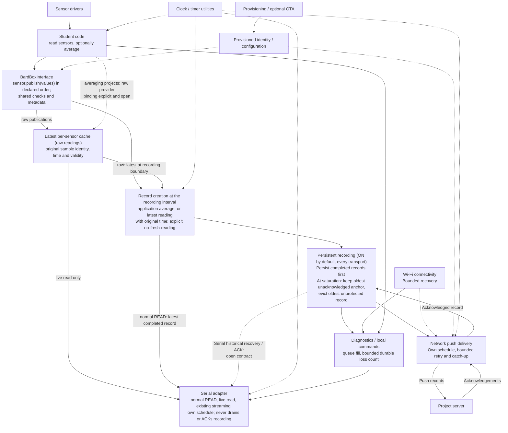
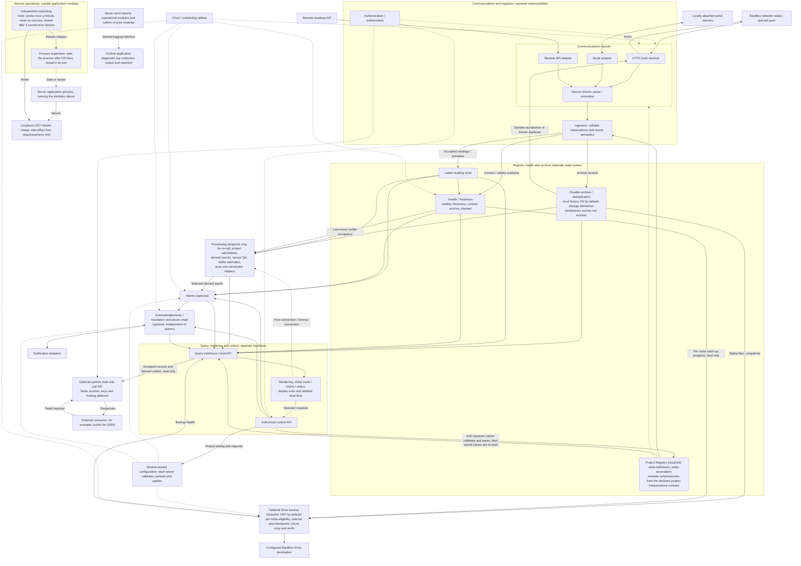
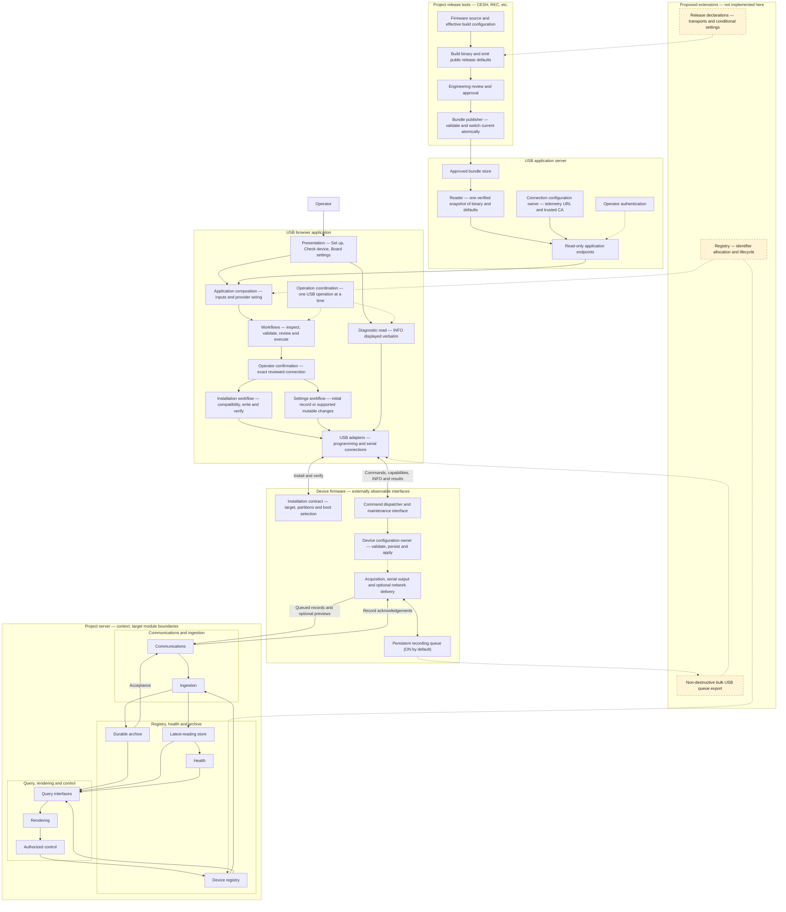

# BardBox Architecture Map

Status: **proposed target design**, recorded October 16, 2026 at Kornelis's request.
Updated October 19, 2026 with accepted direction
([BB-003](https://github.com/bardphysicslab/bardbox/issues/31#issuecomment-6269561991)).
This is the single maintained source for all three diagrams below, not a claim
that their modules are implemented or deployed. Published contracts remain
authoritative. Review and merge are separate from implementation and deployment.

## Diagram index and ownership

| Diagram / contract | Maintained owner and source | Status |
| --- | --- | --- |
| Student-facing firmware template | [Node drawing below](#node-firmware-template) | Target design |
| Project server template | [Server drawing below](#project-server-template) | Target design |
| USB flasher implementation and external boundaries | [USB flasher drawing below](#usb-flasher) | Current implementation map with proposed extensions labelled |
| Firmware lifecycle, layouts and documentation map | [Firmware blueprint](firmware-blueprint.md) | Proposal |
| Student serial/base interface | [Serial/base API](firmware-base-and-serial-api.md) | Beginner API direction accepted (BB-005); exact signatures and compatibility unresolved |
| Persistent delivery queue | [Buffer API](firmware-buffer-api.md) | Proposal |
| USB provisioning contract | [USB flashing and provisioning](usb-provisioning-standard.md) | Proposal |
| OTA lifecycle | [OTA lifecycle contract](ota-update-standard.md) | Optional contract; implementation and physical acceptance tracked separately |

All three diagrams are maintained in this BardBox document. Firmware Tools owns
its implementation code and links here; it does not maintain a second Mermaid copy.
The flasher diagram's abbreviated firmware/server context does not replace the
detailed target drawings or establish that the target is current implementation.
Historical branch copies remain provenance only. The original flasher block was
imported verbatim; the review correction aligns its server context with the
three explicit responsibility groups below.

## Node firmware template

Student code registers sensors and measurements and hands over already-acquired
values with `sensor.publish(...)` through one `BardBoxInterface`
([BB-005](DECISIONS.md), [beginner API](firmware-base-and-serial-api.md#beginner-facing-application-api));
exact signatures remain proposed. Acquisition, record creation at
the [recording interval](firmware-base-and-serial-api.md#recording-interval-and-missing-readings), serial output and network upload have independent
schedules, except that an application may couple its averaging window to record
creation (CESH does). Acquisition and network delivery stay independent of both.

October 19, 2026 accepted direction
([BB-003](https://github.com/bardphysicslab/bardbox/issues/31#issuecomment-6269561991),
items 6–7) is drawn here as target design, not implemented behavior.

**Recording (accepted direction).** Persistent recording defaults ON for every
device running BardBox firmware, including serial-connected nodes. Normal serial
`READ` serves the latest completed record and a live read the latest cached
readings, each with its original identity, time and validity
([normal READ and live read](firmware-base-and-serial-api.md#normal-read-and-live-read)); existing
streaming is unchanged. None of these drains or acknowledges recorded records. Recovering recorded history over
serial needs a separate retrieval/acknowledgement contract that does not exist
yet (dotted arrow). Instruments that do not run BardBox firmware are outside
this requirement. Normal output stays quiet until requested or streaming is
enabled.

**Finite storage (accepted direction).** Records persist before transmission
and remain until acknowledgement. At saturation the oldest unacknowledged
record is kept as an anchor and the oldest *unprotected* record is evicted to
admit the newest; retained records still deliver oldest-first. Eviction is
data loss: it is never an acknowledgement, never ordinary upload-failure
recovery, and its bounded durable count is reported to the server's central
error log when communication permits (no new loss UI). The anchor marks the
earliest retained undelivered measurement, not an exact outage time. Token
safety, power-loss recovery, tiny capacities, compact-chunk representation and
interaction with an explicitly blocked FIFO head
([ingestion contract](ingestion-contract.md#rejected-fifo-records-and-operator-disposition))
remain engineering contract work; existing blocked-head behavior stays the safe
initial rule. This replaces RejectNew as the preferred monitoring default; CESH's
existing RejectNew behavior remains its documented current implementation.
Submission does not imply immediate transmission on all adapters. Bounded
servicing/backpressure and record-creation errors must remain observable.
Optional live-preview delivery follows the [published optional contract](web-node-live-preview.md);
shared runtime extraction/adoption remains pending.
The node drawing shows only the durable baseline and does not claim a shared
preview sender is implemented. Previews never acknowledge queued archival records.
Network outages must not stop acquisition. Maintenance can pause acquisition
only under its separately reviewed lifecycle; no new reboot/power-cycle behavior
is introduced by this drawing.

The device carries provisioned identity and credentials. The server registry
owns registered definitions; writing a UID does not enroll or authenticate it.

## Project server template

**Packaging direction: Docker Compose template (proposal).** Modules describe
responsibility, not one container or service each; logical module boundaries are
not mandatory services. Include scheduled backup as a separate service; each
deployment configures credentials, destination and schedule. This is not evidence
that the existing template already packages these components or satisfies the
published service-recovery requirements, and it does not change the current
native/systemd production model in [reproducible development](reproducible-development.md).

**Minimum and optional capabilities** (accepted October 19,
[BB-003](https://github.com/bardphysicslab/bardbox/issues/31#issuecomment-6269561991)
items 1, 2 and 8–11). The user-facing minimum is a sensor and a way to display
its measurements. Every instance has the Registry and Processing boundaries; a
UID-only demo Registry may resolve schemas and units from the declared project
measurement contract, and Processing may be a no-op. Everything else (alarms,
phone chain, Drive backup, partner read API, serial interface) is selected per
project, and selecting a capability is distinct from its default enabled state.
Selected capabilities keep their identity, validation, security and reliability
obligations. Alarms can run without the phone chain: RKC needs both, CESH neither.

The diagnostic reporting path applies across server modules; the common source
box is a diagram shorthand, not a new controller or runtime module. It is
independent of rendering. Pure ingestion returns structured errors/faults and its
caller logs them; operational modules report their own failures through the shared
logging interface. The logging facility owns collection, output and retention.
Logging grants no archival ACK and does not replace Archive's rejection ledger.
Duplicate-report ownership/correlation is a deferred refinement; occasional
duplicates do not block basic logging. See the
[ingestion diagnostic contract](ingestion-contract.md#diagnostic-logging-independent-of-rendering).
This is target design, not evidence of an implemented central logging facility.

Communications owns transport sessions, framing, deadlines and retries. Source
drivers normalize observations. Ingestion validates registered identity, channels
and record semantics independently of serial or network protocol details.
Authentication applies at every applicable external boundary; the schematic does
not imply only HTTP needs protection. Read/control authorization stays separate.

All BardBox network nodes push in the target. Direct serial sources and remote
API fetching are separate source types, not an alternative TCP-polling model for
BardBox network nodes. Wi-Fi/Ethernet are connectivity beneath HTTP, not peer
application protocols. The optional remote API example does not reinstate the
excluded QuantaQ/PurpleAir integrations.

Archive owns historical persistence/deduplication and its acceptance result.
Only that result can acknowledge an archive record; rejection, preview reception
or a fresh contact cannot dequeue it. Previews have their own non-archive response
semantics. Live publication must follow successful validation and relevant
acceptance; the parallel arrows express responsibilities, not an unsafe write order.

The [proposed ingestion contract](ingestion-contract.md) specifies the normalized
record/delivery interface, partial channel faults, envelope rejection, cadence
and Archive conflict/acceptance semantics. It refines these existing owners;
it does not establish implementation or migrate pilots. The October 19 firmware
recording and saturation direction changes the node drawing's queue labels, not
the ACK rule: only durable acceptance or a known duplicate dequeues a record.

Registry owns node definitions, their association with monitored entities,
device names, locations, latitude/longitude, link type and per-device
configuration. It validates, persists and applies edits through its own
interface; the control API passes edit requests, not prevalidated settings.
For example, longitude must be a finite number in [-180, 180] and latitude
in [-90, 90]. Queries obtain descriptive device metadata from Registry by UID.
Monitored entities (a freezer, Stevenson Roof) have identity independent of
hardware; their settings and history persist through hardware replacement while
records keep their original node attribution
([identity layers](node-naming-standard.md#identity-layers)). For a minimal demo
the Registry may hold only node UIDs and resolve channel schemas and units from
the declared project measurement contract; it remains the resolver even then.
These edits are not sensor-ingestion input.

### Location metadata and observed position

Installation location and coordinates of fixed nodes (freezer monitors, roof
sensors, lab air monitors, room displays) are deployment metadata owned by the
Registry and edited through authorized controls; firmware GPS is usually
unnecessary for them. Current devices have no GPS: the assembler configures
latitude and longitude through the Registry ([UI amendment](https://github.com/bardphysicslab/bardbox/issues/31#issuecomment-6270151957)). A mobile, moving or vehicle-mounted node may legitimately
measure its position with GPS: that position is observation data with time,
units and validity, carried and validated like any other declared channel, not
a replacement for Registry metadata, and compatibility with such future
observations is retained. Rendering labels which one it shows.

### Configuration ownership

Accepted October 19 ([BB-003](https://github.com/bardphysicslab/bardbox/issues/31#issuecomment-6269561991)
item 5). Each owning module validates, persists and applies its own settings and
declares who may edit each one and when a change takes effect. New reference
configuration physically lives in the owning module's subtree, refining the
earlier single-file allowance; existing pilot configuration is not migrated by
this decision, and sync/report tooling, preserved deployment values and protected
secrets must be reconciled before any layout change
([config/report workflow](config-report-workflow.md)). Physical folders for each
module's code, `config/` and saved `data/` are in the
[repository layout](repository-layout.md#application-modules-softwareapp)
([BB-004](https://github.com/bardphysicslab/bardbox/issues/31#issuecomment-6271296848)).

| Settings | Owner | Notes |
| --- | --- | --- |
| Node definitions, entity association, names, installation location/coordinates, link type, per-device cadence | Registry | Required module |
| Project measurement contract: channels, units, validators | Declared by the project; resolved by Registry | Metric default; units always explicit |
| Calculations, derived-result definitions, conversion helpers | Processing | Required module; may be a no-op |
| Alarm thresholds, delays, allowed ranges, and the alarm enable/disable control's meaning, state, permission and label | Alarm (optional) | Thresholds stay in the alarm's units; display units never change alarm semantics. Target: "alarm disabled" pauses notifications/escalation, not measurement or alarm evaluation; manual re-enable ([switch amendment](https://github.com/bardphysicslab/bardbox/issues/31#issuecomment-6270769043)) ([card refinement](https://github.com/bardphysicslab/bardbox/issues/31#issuecomment-6270321987)) |
| Contacts, order, availability, opt-outs, message templates | Phone chain / escalation (optional, independent of delivery channel) | RKC ownership work: [rkc-monitor#16](https://github.com/bardphysicslab/rkc-monitor/issues/16). Acknowledgements and next action are Escalation-owned operational state (inventory row 18), not editable settings; the Escalation card section may display both |
| Display selections: which module-declared sections, status, values and controls appear; optional prominent reading and buffer indicator; display units; timezone presentation | Rendering (shared visual controls and authorized edit path) | Modules declare displayable descriptors; full configuration and secrets are never auto-exposed. Field selection and timezone preference persistence remain open |
| Local history storage allowance and target window | Archive | About two weeks is an adjustable target, not a guarantee |
| Drive backup enablement, schedule, destination | Backup (optional) | Included, OFF by default |
| Freshness, stale and offline thresholds | Health | Per source; offline after stale |
| Partner consumer access | Partner read API (optional) | Key lifecycle and access plan deferred |
| Which modules an instance includes and enables; startup wiring | Composition | [owner supplement](https://github.com/bardphysicslab/bardbox/issues/31#issuecomment-6271666389) (first named Application; renamed by the [naming refinement](https://github.com/bardphysicslab/bardbox/issues/31#issuecomment-6271757925)); not a catch-all for module settings; hot reconfiguration open |
| Remaining project-wide settings without a named module owner | Open (persistent configuration owner) | Not moved into Composition by default |

Authorized web edits follow one sequence: submit through the authorized control
API; the owner validates and saves; then the saved configuration is read back and
rendered, and that refreshed value is the user's check. A failed save keeps the
prior value and is logged centrally. No extra confirmation step is required for
ordinary application edits; hardware installation confirmation in the USB
flasher is unchanged. Rendering depends on configuration owners, never the
reverse.

### Processing, units and time

Processing is required in every instance and may be a no-op. It owns project
calculations and derived scientific values (for example CESH confidence) and
absorbs the former "Analysis / sensor QA" box; it does not take over transport
normalization, ingestion validation, alarm rules or display formatting. It
preserves original measurements and returns derived results separately with
explicit meaning and units. It provides pure conversion and inverse-conversion
helpers: Rendering chooses display units (several at once if useful) and converts
edited values back before saving through the owner, so a display change never
mutates shared observations, configuration or alarm semantics. Processing also
computes buffer estimates (below); it never calls back into Rendering.

BardBox uses metric units by default; interfaces identify units explicitly and
displays label them. All absolute times are UTC across firmware, internal
interfaces, storage and APIs; unknown time stays explicit, and measurement,
observation and receipt time stay distinct. Monotonic elapsed timing remains
valid for intervals and deadlines. Rendering may show local time with an explicit
timezone label; the timezone source (site or user preference) and its
persistence remain open.

**Buffer estimates** (accepted note,
[issuecomment-6269868018](https://github.com/bardphysicslab/bardbox/issues/31#issuecomment-6269868018)).
Processing may estimate, for an offline node, when its finite buffer will fill,
from the last-known occupancy and capacity, the recording interval/rate and the
elapsed time, explicitly assuming the node stays powered and acquiring. It may
estimate when a catch-up backlog clears only when observed net drain supports it,
accounting for continued acquisition; it gives no estimate when the backlog grows
or shows no progress. Estimates are omitted when inputs are insufficient. Rendering
labels them **Estimated** and keeps the last reported actual value distinct.

### Health status and presentation

Status meanings and labels are standard across BardBox
([UI clarification](https://github.com/bardphysicslab/bardbox/issues/31#issuecomment-6269649488)):
a disconnected or unreachable node, a sensor fault and a stale measurement are
different conditions, and alarm state is separate, so healthy communications can
coexist with an active freezer alarm. Health keeps validity, freshness, contact
and `archive_blocked` distinct; the existing reading statuses map onto these
meanings in the [Web UI standard](web-ui-standard.md#standard-status-meanings).
The full main-status vocabulary, its precedence and how a card combines labels
remain open; "catching up" is only a supplementary indication beside the buffer
indicator ([UI amendment](https://github.com/bardphysicslab/bardbox/issues/31#issuecomment-6270151957)). Latest state preserves measurement time separately from
receipt/contact time, so Health can show a connected node delivering old records
without calling them fresh. The latest value is the newest valid measurement by
trustworthy measurement time; older catch-up arrivals go to history and never
regress it.
Registry definitions, latest state and historical archive are different owners.

The rendering layer reads through query interfaces, not ingestion. Cards are led
by the monitored entity or place, with contributing hardware identity and health
beneath, following the shared rough structure in the
[Web UI standard](web-ui-standard.md#card-top-area). Availability of a field never
implies its display. Card sections come from included modules: Identity and
Health are common, Hardware, Sensor QA and sensor groups optional, and a standard
Escalation section appears only when escalation is included
([Web UI standard](web-ui-standard.md#card-sections-from-included-modules)).
Operator requests pass through authorized control interfaces;
the browser owns neither alarm timing nor safety decisions.

Timer utilities provide clocks/deadlines (mechanisms); each module keeps its own
scheduling policy. Alarm and escalation modules own their policy and state and
are optional and independent of each other. Notification providers execute
delivery rather than deciding alarm policy. Projects select optional
capabilities and configure thresholds.

### Local history and backup

Accepted October 19 (BB-003 item 8); target design, not implemented behavior.

- **Local history** is ON by default (a disposable demo may omit it) with a
  configurable storage allowance and reserve; about two weeks is an adjustable
  target, not a guarantee.
- **Drive backup** is included but OFF by default. With backup OFF, local history
  is an ordinary rolling window: no permanent oldest anchor and no network-failure
  errors merely because backup is disabled.
- **Enabled backup failing at saturation:** keep a per-node oldest-unbacked
  anchor plus the newest data, evicting the oldest unprotected records. This
  exceptional loss of unbacked data is distinct from ordinary cleanup of exact
  verified versions.
- **Discards** are logged to the central error log; no new loss UI.
- **Tombstones:** acceptance/deduplication tombstones survive row eviction so an
  exact lost-ACK retry stays ACK-eligible without recreating removed history;
  exhausted protected metadata or an inconsistent restore still fails closed until
  reconciled ([ingestion contract](ingestion-contract.md#envelope-rejection-and-durable-acceptance)).
- Enabled state of backup must not be confused with the foundational restore and
  retention safeguards below.

Backup runs periodically (for example hourly or daily) without blocking ingestion,
queries or rendering. Follow [service operations](service-operations-standard.md):
copy rather than destructive sync; lock runs; verify stable versions before
recording manifests; failed transfer/verification never advances deletion eligibility.
Ordinary verified-backup cleanup deletes only explicitly eligible exact versions.
That rule does not govern the two accepted finite-storage cases described in
[local history and backup](#local-history-and-backup): the backup-OFF rolling
window and enabled-backup failure at saturation, whose evictions are logged
centrally. Tombstone and deduplication metadata stay protected and fail closed
in every case, and copy/verify invariants are unchanged. Credentials stay local
and outside repositories/read APIs. Restore acceptance and retention configuration
remain deployment work. A container packaging choice does not waive process or
application-watchdog requirements.

**Per-node catch-up and backup boundary.** Proposed shared contract, under review.
- **Inputs and ownership:** Backup reads authenticated, current per-node
  catch-up and queue progress from Health and delivery diagnostics. Backup owns
  per-node file eligibility, deferral and backup checkpoint state.
- **Transport only:** rclone only copies and verifies.
- **Per-node independence:** while one node catches up, other nodes' files stay
  independently eligible.
- **Authority:** Archive's per-node files remain the authoritative history.
- **Deferral until evidence:** a catching-up node's files stay deferred until
  there is reliable completion evidence. Losing diagnostics, a timeout or an
  expiry must not, on its own, silently clear the deferral or make those files
  eligible. The visibility and escalation bound is D12; the completion
  mechanism is still open.
- **Not a control path:** a deferral is not an ACK and does not control
  catch-up. Backup has no ingestion dependency and never rewrites measurement
  content. Within backup-driven cleanup, only the existing, separately
  authorized retention of verified exact versions may remove local copies; the
  accepted backup-OFF rolling window and saturation eviction are separate,
  logged storage policies.

Current CESH behaviour is described separately from that target:
- **Source** (pinned in the [evidence](server-data-inventory-evidence.md)): the
  server writes a per-node deferral entry from node-reported queue progress, and
  legacy firmware never creates one. The backup script skips a deferred node's
  files and never copies today's active daily CSV, so Drive is not a live copy
  of the current day. It copies changed eligible files, verifies them, and only
  then advances the manifest and local retention.
- **Deployment:** a read-only check on 2026-10-17 found an active timer and
  successful recent runs. Logs showed real deferrals on October 15 and 16 (runs
  skipping 67 and 75 files) and no deferred nodes at inspection. The deployed
  server's runtime handler was not audited.

Limits, kept open as D12:
- Logs and successful jobs do not prove that every record reached Drive.
- A node with missing, stale or untrustworthy progress diagnostics has no
  reliable completion evidence.
- A deferral entry left by a node that went offline has no visibility or
  escalation bound yet, and an expiry must not silently make its files
  eligible.
- Selection, copy and verification can race with late arrivals. A file version
  that changes after a late record arrives must be copied and verified again
  before retention.
- No completion policy is defined here.

**Optional partner read API (direction accepted October 19, BB-003 item 9).**
External consumers pull data; the server does not push to them. This replaces
the earlier undecided push-or-pull export. It is distinct from incoming
third-party collection (outside BardBox), notifications and backup.
- **Read only:** consumers request readings through the query and Processing
  read interfaces. No ingestion, settings, Registry/location or hardware
  mutation, no Archive ACK role, and no change to history.
- **Pattern:** inspired by PurpleAir's registered-consumer pattern (latest
  readings and historical time ranges); this is not drop-in PurpleAir
  compatibility and reinstates no PurpleAir integration.
- **Security boundary:** reuse the authenticated read-only boundary's posture
  ([Data API/MCP boundary](data-api-mcp-boundary.md)) without its file-download
  shape. Consumer authorization is tracked separately from device registry and
  upload credentials, under the one Authentication/authorization owner.
- **Independence:** consumer load is bounded so requests never block ingestion,
  durable acceptance or ACKs.
- **Example:** CESH's JustAir access, tracked in
  [cesh-air-monitor#35](https://github.com/bardphysicslab/cesh-air-monitor/issues/35).
  RKC does not need it.
- **Deferred (D10):** exact fields and bounds, authentication and key
  lifecycle, and the hosting/access plan. Existing network restrictions
  ([network access](network-access.md)) stay in force for any deployment until
  an authorized access plan exists; that does not redefine external consumers
  as internal-only. No public exposure or provider contact is authorized.

**Service supervision and application watchdog.** These follow
[service operations](service-operations-standard.md).
- **Process supervision:** a supervisor starts the application process after
  the operating system boots and restarts the process whenever it exits (for
  systemd, `Restart=always` and `RestartSec=5`).
- **Application watchdog:** an independent oneshot timer calls the loopback
  `GET /health` served by that process once a minute. After three
  consecutive failures it asks the supervisor to restart the process. A
  success resets the count.
- **`/health` stays cheap and side-effect free:** no sensor, database, file or
  network checks.
- **Scope:** this watchdog measures application responsiveness only. Sensor
  and node freshness belong to the Health module, which does not supervise
  processes. Recovering the host itself (a hung host or power loss) is a
  separate concern, not covered here (D11).
- **Docker Compose:** a restart policy restarts exited containers but does not
  detect a hung application, so packaging does not replace the independent
  watchdog.

Historical tool access remains the [authenticated read-only Data API/MCP boundary](data-api-mcp-boundary.md).
The dashboard control API is not an extension of that historical-data boundary.

### Server data inventory and module operations

**Status: proposed for review (October 16, 2026), not settled policy.** This is
an initial, category-level inventory of the data CESH and RKC collect or use. It
was checked against CESH `259cba6` and RKC `0c4f923`; categories found later are
added here.
- **Current implementation** describes those revisions. Its evidence is pinned in
  the companion [source evidence](server-data-inventory-evidence.md).
- **Target owner** follows the diagram above and the
  [ingestion contract](ingestion-contract.md).
- **Gap** entries are review observations, not decisions.
- **October 19 update:** owners settled by the accepted
  [BB-003 entry](https://github.com/bardphysicslab/bardbox/issues/31#issuecomment-6269561991)
  (Processing, Rendering display settings, phone-chain contacts, partner read
  API, history/backup policy) are reflected below; other rows are unchanged.

All measurements are one category, sensor data. Credentials are listed by
purpose and storage location only. Third-party comparison feeds (PurpleAir,
QuantAQ) and their API keys are outside BardBox and belong in separate
repositories ([bardbox#28](https://github.com/bardphysicslab/bardbox/issues/28);
see [required migration](#required-migration-and-limits)), so they are not
inventoried here. Science computed from BardBox measurements stays in scope. Module numbers refer to the
[server roadmap](https://github.com/bardphysicslab/bardbox-project-template/issues/31).

| # | Data category | Origin | Target owner | Projects | Current implementation | Gap for review |
| --- | --- | --- | --- | --- | --- | --- |
| 1 | Sensor data (all measurements) | Node sensors | Archive (history); Latest (current view) | Both | Current: CESH nodes push aggregates (stored in per-node daily CSV); RKC server polls nodes over TCP (interval CSV log) | Target for both: node-initiated queued push. RKC polling is a required migration, not a permanent design ([required migration](#required-migration-and-limits)). Per-channel faults and unknown time per contract; history and saturation policy accepted (BB-003 item 8), enforcement detail D3 |
| 2 | Derived science and QA results | Processing | Processing (required; project-owned definitions); storage undecided (D1) | CESH | Project-owned derived confidence and advisories computed from BardBox measurements, written into archive CSV rows | D1 |
| 3 | Device identity and bindings (UID, reported/legacy alias, archive device key, node-to-entity association; factory MAC deferred) | Provisioning; Registry | Registry | Both | UID lists in config files; firmware UID in NVS (CESH) or build (RKC) | Archive device key not implemented |
| 4 | Record identity, dedup and acceptance (record ID, source digest/profile, tombstones, rejection ledger, ACK outcome) | Node (ID); Communications (digest); Archive | Archive | CESH; RKC after push | CESH: ID-only check against an in-memory set rebuilt from CSVs. RKC: none (polling) | Content-aware durable dedup per contract |
| 5 | Times (measurement, receipt, observation, contact, acceptance, event) and clock quality | Node clock; server clock | Ingestion validates; Clock supplies server time | Both | CESH: device time with RTC/NTP flag; falls back to receipt time. RKC: server poll time | Receipt-time fallback removed; observation basis labelled |
| 6 | Firmware and protocol versions | Node | Archive (original record); Communications (supported list) | Both | CESH: in payload. RKC: optional cached INFO | Required original metadata per contract |
| 7 | Link and delivery diagnostics (RSSI, node queue counts, catch-up, errors, sensor-health counters) | Node | Archive (original record); Health (current delivery) | Both | CESH: payload fields, with `current_*` appended at send time. RKC: RSSI inside data | Split original from delivery diagnostics; bounded durable firmware loss counts reach the central log (BB-003 item 7) |
| 8 | Health and freshness projections (contact, stale/offline, `archive_blocked`) | Health | Health | Both | CESH: offline after three expected intervals. RKC: observation state per poll sweep | Backup scope (D4) |
| 9 | Cadence (reporting, acquisition, retry/catch-up, poll, logging) | Firmware; configuration | Registry (per device); configuration owner (project default) | Both | CESH: reported seconds, last value cached in memory. RKC: configured poll and log intervals | Millisecond precision and precedence per contract |
| 10 | Channel definitions, units and validity metadata | Declared project measurement contract | Registry resolves (a minimal demo Registry may hold only UIDs) | Both | Hard-coded per driver or node type | Contract format; archived snapshot (D5) |
| 11 | Registration and descriptive metadata (monitored entities with entity ID, display name and separate location, installation coordinates, owner, notes, enabled, legacy host/port) | Operators | Registry | Both | JSON app config; RKC admin edits written back to config | Backup scope (D4) |
| 12 | Alarm thresholds and alarm configuration (limits, delays, arm and door flags) | Operators | Alarm module (optional) | RKC | Per-node app-config fields, edited by admin and alert endpoints. The RKC CSV log reuses `min_temp_c`/`max_temp_c` for observed interval extremes | Kept distinct from ingestion validity limits; backup scope (D4) |
| 13 | Project configuration (titles, timezone, clock and freshness policy, poll/stale/offline, feature flags, retention, backup policy) | Operators | Persistent configuration owner | Both | JSON app config, environment overrides, backup env file | Backup scope (D4) |
| 14 | Display settings (visible fields, order, labels, optional prominent reading and buffer indicator, display units, timezone presentation) | Project | Rendering (module-owned configuration) | Both | Templates and code | Field selection and timezone preference persistence (D2) |
| 15 | Users, roles and sessions (operator identity — not device UID) | Operators | Authorization at the control and query boundaries | Both | RKC: one admin login from environment; no user IDs or roles. CESH: no dashboard login; machine bearer token for the historical Data API | Operator user/role model (D6) |
| 16 | Credentials (references only): device telemetry tokens, Data API token, admin login, SMTP, Twilio, rclone remote, device Wi-Fi/OTA secrets, partner export credentials (future) | Deployment; provisioning | Deployment secret storage outside source. Communications authenticates devices and Registry owns identity bindings (per the ingestion contract); issuance and lifecycle are separately owned ([firmware-tools#41](https://github.com/bardphysicslab/firmware-tools/issues/41)) | Both | Environment variables, local config, rclone config, device NVS | CESH firmware sends a device token the server does not check; issuance scheme and credential-to-identity integration contract (D7) |
| 17 | Contacts and availability (people, phone/email, order, availability, opt-outs) | Operators; inbound SMS | Phone chain / escalation (optional); RKC implementation in [rkc-monitor#16](https://github.com/bardphysicslab/rkc-monitor/issues/16) | RKC | App config, updated by the admin page and inbound STOP | D4 |
| 18 | Alarm, escalation, acknowledgement and notification state (incidents, acknowledgement windows, processed inbound IDs, incident log, templates) | Alarm module; providers | Alarm and escalation modules | RKC | In-memory alert state; processed-ID JSON file; incident CSV copied by rclone | Restart durability; D4, D6 |
| 19 | Inbound messages and request logs (SMS replies, sender numbers, unknown-node attempts with remote IP) | External senders | Communications diagnostics; notification adapter | Both | CESH logs rejected-UID attempts. RKC parses SMS replies (webhook and poller) | Retention and privacy (D9) |
| 20 | Backup and recovery state (manifest, deferrals, lock, restore checkpoints) | Backup | Backup service, with Archive restore reconciliation | Both | CESH: rclone every 30 minutes, manifest, per-node catch-up deferral file, lock, verified local retention deletion; today's active CSV is never copied. RKC: incident-log copy only | No restore drill yet; completion evidence and deferral bounds (D12) |
| 21 | Partner read API configuration and state (field mapping, consumer key references, request bounds, access status and errors) | Operators; partner read API | Optional partner read-only pull API | CESH (future) | None | Fields, bounds, authentication/key lifecycle and hosting/access plan (D10) |
| 22 | Service liveness and restart state (liveness response, watchdog failure count, restart events) | Application process; watchdog; supervisor | Service operations, outside application modules | Both | Both repositories have a one-minute watchdog timer, a loopback `/health` probe script and a failure-count file (CESH [timer](https://github.com/bardphysicslab/cesh-air-monitor/blob/259cba6951332b7ba48e3111c7a0f132c8036891/deploy/cesh-air-watchdog.timer), [script](https://github.com/bardphysicslab/cesh-air-monitor/blob/259cba6951332b7ba48e3111c7a0f132c8036891/scripts/cesh-air-watchdog.sh); RKC [timer](https://github.com/bardphysicslab/rkc-monitor/blob/0c4f9238a7c85f282a69d92f4142c6eea06f184e/deploy/rkc-monitor-watchdog.timer), [script](https://github.com/bardphysicslab/rkc-monitor/blob/0c4f9238a7c85f282a69d92f4142c6eea06f184e/scripts/watchdog.sh)). Full conformance with the standard not audited | Separate from sensor freshness; host recovery (D11) |
| 23 | Application diagnostic events (component, stage, reason, available time and device/record identity) | Operational modules; application callers of pure modules | Shared diagnostic logging facility (collection, output and retention) | Both (target) | Existing logs are not audited here; no shared logging conformance claimed | Explicit shared reporting per ingestion contract; output, access and retention configuration remain to be specified; duplicate-report ownership/correlation deferred |
| 24 | Buffer estimates (time until an offline node's buffer fills; catch-up clearing time when net drain supports it) | Processing, from last-known occupancy/capacity (row 7) and recording rate | Processing (derived, transient); Rendering labels them Estimated | Both (target) | None | Inputs and display placement; omitted when inputs are insufficient |

#### Proposed target: module operations by data category

The matrix shows the **proposed target design, not current behavior**.

| Mark | Meaning |
| --- | --- |
| C | Create |
| R | Read only. V, T, D and X each include reading the data. |
| V | Validate or verify |
| T | Transform or derive |
| S | Store as owner or durable copy |
| D | Display |
| X | Transmit to another module, a node or a provider. This includes ACKs and pass-through record envelopes. |
| Del | Delete |
| ? | Undecided; see decisions D1–D12 |
| — | No access in the proposed design |

Column 10 covers the authorized control API and the persistent configuration
owner. For data owned elsewhere it passes edit requests (X) to that owner, which
validates and stores them.

| # | Ingestion 01 | Registry 02 | Clock/startup 03 | Archive 04 | Communications 05 | Backup 06 | Latest/Health 07 | Query/Render 08 | Controls/config 10 | Processing 11 (required) | Alarms 12 | Serial 13 (optional, low) | Partner read API (optional) | Diagnostic logging (shared facility) |
| --- | --- | --- | --- | --- | --- | --- | --- | --- | --- | --- | --- | --- | --- | --- |
| 1 Sensor data | V T | — | — | S Del ? | T X | X | S | D | — | R | R | C T X | T X | — |
| 2 Derived science | — | — | — | ? | — | ? | — | D | — | C T | ? | — | ? | — |
| 3 Device identity | V | C V S | — | S | V X | X | R | D | X | R | R | R X | T X | — |
| 4 Record ID, dedup, acceptance | V | — | — | C V S | C X | X | R | D | — | — | — | — | ? | — |
| 5 Times, clock quality | V T | — | C | S | C X | X | T | D | — | R | R C | C | T X | — |
| 6 Firmware/protocol | V | — | — | S | V X | X | S | D | — | — | — | X | — | — |
| 7 Link/delivery diagnostics | V T | — | — | S | T X | R X | S | D | — | — | R | X | — | — |
| 8 Health projections | — | — | — | — | — | R ? | C S | D | — | — | R | — | — | — |
| 9 Cadence | V T | V S | R | S | X | X | R | D | V S X | — | R | R | — | — |
| 10 Channel definitions | R | C V S | — | ? | R | ? | R | D | X | R | R | R | R | — |
| 11 Registration metadata | — | C V S | — | — | R | ? | — | D | X | — | R | R | ? | — |
| 12 Alarm thresholds | — | — | — | — | — | ? | — | D | X | — | V S | — | — | — |
| 13 Project configuration | R | — | R | R | R | R ? | R | D | C V S | R | R | R | R | — |
| 14 Display settings | — | — | — | — | — | ? | — | D | X ? | — | — | — | — | — |
| 15 Users, roles, sessions | — | — | — | — | — | — | — | V | V | — | ? | — | — | — |
| 16 Credentials | — | ? | — | — | V | R | — | V | V | — | R | — | R | — |
| 17 Contacts | — | — | — | — | — | ? | — | D | X | — | V S | — | — | — |
| 18 Alarm/notification state | — | — | — | — | — | X ? | — | D | X | — | C T S X Del | — | — | — |
| 19 Inbound messages/logs | — | — | — | — | C X | ? | — | ? | — | — | T | — | — | — |
| 20 Backup/recovery state | — | — | — | R | — | C S Del | R | D | — | — | — | — | — | — |
| 21 Partner read API config/state | — | — | — | — | — | ? | — | D | X | — | — | — | C V S X | — |
| 22 Service liveness/restart | — | — | C X | — | — | — | — | — | — | — | — | — | — | — |
| 23 Application diagnostic events | C (returned faults only) | C X | C X | C X | C X | C X | C X | C X | C X | C X | C X | C X | C X | C S Del |
| 24 Buffer estimates | — | — | R | — | — | — | R | D | — | C T | — | — | — | — |

Notes:
- **Application diagnostic events (23)** are separate from inbound messages/request
  logs (19), node delivery diagnostics (7) and Archive's rejection ledger (4).
  `C X` in this row means a module may create/report errors it detects in its own
  work; it grants no access to other modules' data. Pure ingestion creates
  structured returned faults only. Its application caller transmits diagnostic
  entries through the shared logging interface; the validator performs no log I/O.
  Other pure modules follow the same caller-reporting boundary when applicable.
- **Diagnostic logging** is a cross-cutting facility, not a new numbered server
  roadmap stage or controller. It stores diagnostic events only, not measurement
  history, credentials or acceptance state. `Del` applies only under a defined
  retention policy, not permission to erase arbitrary evidence. Output/storage,
  protected maintainer access and retention settings need specification before
  implementation; this table selects no external service or public log endpoint.
  Query/rendering may report their own failures, but displaying diagnostic events
  is not required: the facility's protected maintainer access is independent of
  rendering. Backup of these logs is not assumed. The `C` in the logging column
  allows reporting its own failures, not recursive self-logging without bounds.
  Duplicate-report ownership/correlation remains deferred, not an initial blocker.
- **Backup (06)** copies whole archived record envelopes, including device keys,
  original metadata, times, cadence and diagnostics. Restore reconciles archive,
  deduplication and identity-key state before accepting writes, as the ingestion
  contract requires.
- **Backup per-node deferral** reads current catch-up progress (rows 7 and 8)
  and owns eligibility, deferral and checkpoint state (row 20). It is not an
  ACK, not a catch-up controller and not an ingestion dependency. Archive's
  per-node files stay authoritative.
- **Credentials (16)** are read or verified only at the boundary that uses them:
  device authentication in Communications, operator login in Controls,
  historical Data API access in Query, and provider credentials in Alarms and
  Backup. No module displays or returns secret values. Clock/startup has no
  credential access merely by sharing a process. Registry's "?" in row 16 is
  only about what credential-related data, if any, the integration contract
  (D7) places beside the identity bindings Registry already owns.
- **Serial (13)** is optional and low priority; neither CESH nor RKC needs it.
- **Partner read API** (optional, no roadmap card yet) answers consumer pull
  requests through query and Processing read interfaces only, never through
  ingestion or Archive acceptance, and changes no history. Request load is
  bounded so it cannot block ingestion or durable ACKs. Its status (21) is
  readable through Query. Row 1's "T X" in this column is field mapping for
  responses, not a push.
- **Processing (11)** replaces the former "Science" column: it is required in
  every instance and may be a no-op. Row 24 estimates are derived values it
  computes; Rendering only displays them, labelled Estimated.
- **Service liveness (22):** the application composition (column 03) serves
  `/health` and creates only a transient response; no module stores it. The
  Health module (07) owns sensor and node freshness, not process supervision.
  Operations data outside the modules is mapped below.

| Liveness data (22) | Application process | Watchdog timer | Process supervisor |
| --- | --- | --- | --- |
| `/health` response (transient) | C X | R | — |
| Consecutive-failure count | — | C S Del (reset on success) | — |
| Restart requests and restart events | — | C X | R S (deployment-specific log) |
- **Integration items** (the synthetic demo 09 and CESH/RKC adoption 14–15) own
  no data categories.

**Decisions needed (not settled here):**
- **D1** Storage and backup owner for derived science values.
- **D2** *Owner resolved October 19:* Rendering owns display configuration as
  module-owned settings (BB-003 items 5 and 10). Still open: exact field
  selection and placement, and where a site or user timezone preference is
  stored.
- **D3** *Policy accepted October 19* (BB-003 item 8: history ON with a storage
  allowance, backup-OFF rolling window, enabled-backup per-node anchor, tombstones
  surviving eviction). Still open: which component enforces the allowance and
  stores tombstones compactly, and power-loss/restore evidence. CESH's backup
  script deletes local readings today.
- **D4** Backup scope for registry data, configuration, thresholds, contacts,
  alarm state, health projections and request logs.
- **D5** Whether Archive keeps a channel-definition snapshot for later
  interpretation of records.
- **D6** Operator user and role model, and whether acknowledgements bind to an
  operator identity.
- **D7** Device credential issuance and lifecycle scheme, and the concrete
  contract linking a credential to its registered identity
  ([firmware-tools#41](https://github.com/bardphysicslab/firmware-tools/issues/41)).
  The existing owners are settled by the ingestion contract: Registry owns
  identity bindings and archive device keys, and Communications authenticates.
- **D8** *Resolved October 19:* the phone chain owns contacts and templates
  (BB-003 item 5); RKC implementation is
  [rkc-monitor#16](https://github.com/bardphysicslab/rkc-monitor/issues/16).
- **D9** Retention and privacy rules for inbound messages and request logs.
- **D10** *Direction resolved October 19:* read-only pull (BB-003 item 9).
  Still open: exact fields and bounds (including whether location or derived
  values are shared), authentication and key lifecycle, and the hosting/access
  plan ([cesh-air-monitor#35](https://github.com/bardphysicslab/cesh-air-monitor/issues/35)).
- **D11** Whole-host and power-loss recovery (for example hardware watchdog or
  power protection), separate from the application watchdog.
- **D12** Backup completion evidence and per-node deferral limits:
  - what counts as reliable completion evidence;
  - handling of missing or stale progress diagnostics;
  - a visibility or escalation bound for long-lived deferrals, without
    automatically clearing them;
  - the completion-evidence mechanism that ends a deferral;
  - version-snapshot rules for late arrivals.

**Per-module contract checklist** (fill in when a module's contract is written):
1. Data categories touched (its matrix column) and the owner of each.
2. Operations and invariants for each category.
3. State owned, persistence and backup scope.
4. Authorization boundary and credentials used.
5. Failure, retry and restore behaviour.
6. Open "?" decisions resolved, or explicitly deferred.
7. New categories found are added to this inventory.

## USB flasher

Diagram home: this BardBox Architecture Map. Implementation owner: Firmware Tools.
Imported from its reviewed-source candidate [2d036ed](https://github.com/bardphysicslab/firmware-tools/blob/2d036ed8918f73e4671d9ccdbdcd854e88faba28/docs/usb-flasher-architecture.md)
at Kornelis's request to centralize all three diagrams. That historical copy is
provenance only; future diagram changes are made here with the owning code change.

Implementation baseline: Firmware Tools `5142b97`, CESH firmware `34ff50a`
(0.11.0), release metadata emitter `259cba6`, and BardBox contract `f5a0cd6`.
The USB page and release-defaults bundle were deployed on 2026-10-16; delivery
and physical evidence live in [the authoritative tracker](https://github.com/bardphysicslab/firmware-tools/issues/5).
The diagram describes responsibilities, not a claim that every firmware/server
module has already been extracted into a shared library.

### Layers

### Boundary contracts

| Owner | Inputs, outputs and preserved responsibility |
| --- | --- |
| Project build/release tools | Produce firmware and public defaults from the named source commit and effective build configuration. Compiled defaults and approved operator proposals retain distinct provenance. A metadata-only release may reuse an existing exact binary; this is not a rebuild. |
| Publisher and bundle reader | Approval covers exact input digests, including optional release metadata. The reader serves one verified snapshot; an operation must not mix release versions. Existing bundles without metadata remain readable. |
| USB host configuration | Currently supplies telemetry URL and public trusted CA. These are not sensor properties or per-device registration credentials. Release-owned form defaults do not silently come from host defaults. |
| Browser presentation and workflows | One Board settings form prefills from the approved release. Save selects/reads a board, validates the whole plan and offers one review. Confirmation covers that connected target only. Workflows enforce sequencing and stop after failed or uncertain steps, reporting partial results; multiple writes are not claimed atomic. |
| Firmware installation interface | Target/layout compatibility, boot selection and startup confirmation are separate from internal sensor/application structure. Valid matching-layout updates preserve configuration and queued data. Recovery has separate explicit data-loss confirmation. |
| Firmware configuration/maintenance | Firmware validates commands, owns persistence and reports capabilities/limits. Initial identity/server records remain immutable through this workflow; supported Wi-Fi and interval changes use separate mutable settings. Interval changes require restart. INFO remains a raw diagnostic reply. |
| Network node and project server | The node communicates directly with its destination after setup. The flasher is not a readings relay. A preview does not dequeue a record; queued records remain until durable server acceptance or known duplicate. Server history ordering and rendering belong to the server. |

### Current limits and proposed evolution

- Today: one current approved CESH TEST bundle, Wi-Fi-oriented provisioning,
  manually entered established identifiers, and no release selector in assembly.
- Proposed: release-declared transports and conditional settings, allowing a
  serial-only node without mandatory Wi-Fi/endpoint/CA fields. Firmware internals
  and student-facing publish API may evolve without changing USB clients when
  external contracts remain compatible. LoRa support is not implemented.
- Proposed registry integration is optional and uses explicit service interfaces;
  writing an identifier to a board does not register it with a receiving server.
  An identifier is not an authentication credential. Credential issuance remains
  a separate unresolved contract.
- Planned bulk queue export is read-only and non-destructive, not a serial delivery
  queue. Overflow-policy changes remain separate deferred firmware work.
- October 19 consistency check: the node and server drawings changed (recording
  ON by default, saturation anchor, required Processing, partner read API). The
  flasher's abbreviated server context needs no new arrow; its queue label now
  says recording. Hardware installation confirmation in the flasher is
  unchanged. Applying the Processing building block (conversion helpers, such as
  showing 120 s for a 120,000 ms firmware value) to the flasher itself is a
  deferred idea for Firmware Tools, not a requirement.
- OTA engineering is a separate application/workflow. It may share bundle validation
  and approval components; it owns assignments, authenticated network delivery,
  health validation and rollback. Neither app requires the other to be running.

Shared format definitions remain in [BardBox USB device configuration and selection](https://github.com/bardphysicslab/bardbox/blob/main/docs/usb-device-configuration-standard.md).
This implementation map does not replace those contracts, the project firmware
blueprint or the separately proposed server template architecture.

## Required migration and limits

- RKC server-initiated TCP polling must be replaced with node-initiated push.
  It is pending migration work, not a permanent option in this target.
- Remove QuantaQ and PurpleAir integrations from CESH and exclude both from
  the template. These removals are planned, not completed by these documents.
- Extract reusable capabilities incrementally. CESH's queue is a concrete first
  candidate; preserve queue format/ACK behavior and fault evidence. This is a
  recommendation, not implementation authorization.
- Adoption order (BB-003 item 11): CESH's real requirements and reusable code
  first, in a development instance of the shared template, then RKC to prove
  reuse. Synthetic fixtures support checks; no separate pretend project is
  required. Required Processing starts as a no-op. Pilots and compatible history
  are preserved; firmware migration is separately owned.
- Existing project sources can differ from these targets. The earlier print PDF
  is a discussion snapshot and predates rendering, backup and push-only refinements.
- Registry synchronization, saturation-policy engineering detail, status/schema compatibility,
  sensor/channel partial validity, independent consumers, hardware queue survival,
  and flasher/OTA lifecycle acceptance remain explicit review/adoption work.
- Applicable [Bard web policy and service guidance](https://github.com/bardphysicslab/engineering-standards/blob/main/docs/bard-it/README.md)
  remains separate authority. No provider, hosting or institutional compliance
  determination is made here.

## Keeping work aligned

Use the phrase **Check against the BardBox Architecture Map** in task prompts.

Before firmware, server, USB or OTA changes:
1. Read this map and the applicable linked contract/implementation diagram.
2. Resolve and record the governing BardBox main revision; record exact pending
   proposal and consumer revisions separately. A diagram branch is not adopted policy.
3. Name the affected operations, data/state owners, permissions, failure behavior
   and compatibility/versioning consequences.
4. Update the relevant diagram in this document and its linked contract when
   changing a boundary. Check the other two diagrams for consistency and record
   the result. Do not silently implement a draft or copy Mermaid into consumers.
5. In the PR, record the revision checked, conformance or deliberate gaps, affected
   consumers, and relevant tests/evidence. Review those claims before merge.

BardBox owns shared contracts and the single source for all three architecture
diagrams. Firmware Tools owns flasher implementation and links here. Its repository
instructions require this entry point alongside applicable main standards. Links
and checklists improve traceability; they cannot guarantee understanding or prove
runtime conformance. Automated link/evidence checks may supplement independent
semantic review; no new CI enforcement is installed by this documentation update.

Decision: keep all three diagrams physically in BardBox, in this one document.
The earlier proposal of a distributed index was rejected by Kornelis because he
wants one place to edit the overall design and compare related diagrams. Consumers
link here; their code, acceptance evidence and detailed operating docs remain in
their own repositories. Exact source revisions preserve provenance.

## Evidence and provenance

October 16 review reconciliation checked current BardBox main `f5a0cd6`,
[USB configuration/selection](usb-device-configuration-standard.md), CESH `34ff50a`
and Firmware Tools `5142b97`. These source facts supplement the task's retained
governing commit below; they do not silently switch its policy baseline.
The server and flasher context now share three responsibility groups. Runtime
state does not become one combined owner merely because it shares a visual group.

Direction: [original communications North Star](https://github.com/bardphysicslab/bardbox/issues/31#issuecomment-6190826224),
[functional drawings](https://github.com/bardphysicslab/bardbox/issues/31#issuecomment-6220370776),
[required migration clarification](https://github.com/bardphysicslab/bardbox/issues/31#issuecomment-6224357842),
and [flasher cross-link handoff](https://github.com/bardphysicslab/bardbox/pull/32#issuecomment-6224677892).
The subsequent October 16 conversation added communications/ingestion separation,
rendering, configurable scheduled backup and this central entry point.

Shared guidance: bardphysicslab/engineering-standards@341b3ba82503eb23b786dfcf71af430cc627e2a5
BardBox standards: bardphysicslab/bardbox@143d42976fd224e8609ee90744ba490a91df1819

October 19 reconciliation (OCT19-DOCS-1) applied the accepted
[BB-003 entry](https://github.com/bardphysicslab/bardbox/issues/31#issuecomment-6269561991),
its [UI clarification](https://github.com/bardphysicslab/bardbox/issues/31#issuecomment-6269649488)
and [buffer-estimate note](https://github.com/bardphysicslab/bardbox/issues/31#issuecomment-6269868018)
to all three drawings and the tables above.
Shared guidance: bardphysicslab/engineering-standards@2cb958318b5b603b2b250c351425212e10a64fed
BardBox baseline: bardphysicslab/bardbox@31100b88958299560b672d88030bc8e11585d2dd

Existing earlier records retain their own governing commits. This proposal adds no
runtime implementation, template code, firmware change, skill change, migration,
merge, deployment or physical acceptance. It must be reviewed at its exact commit.
