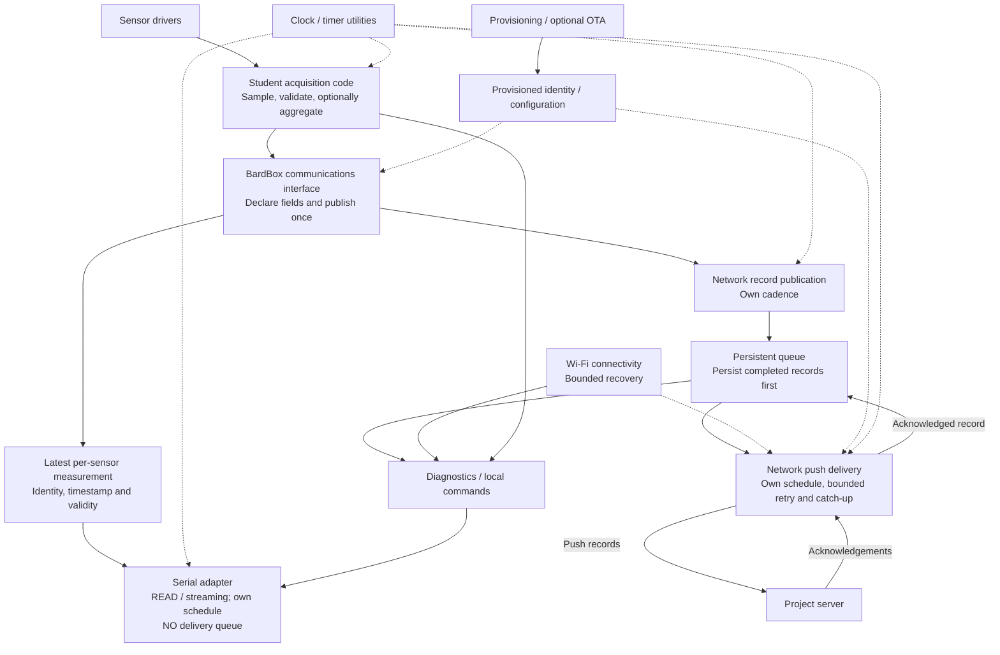
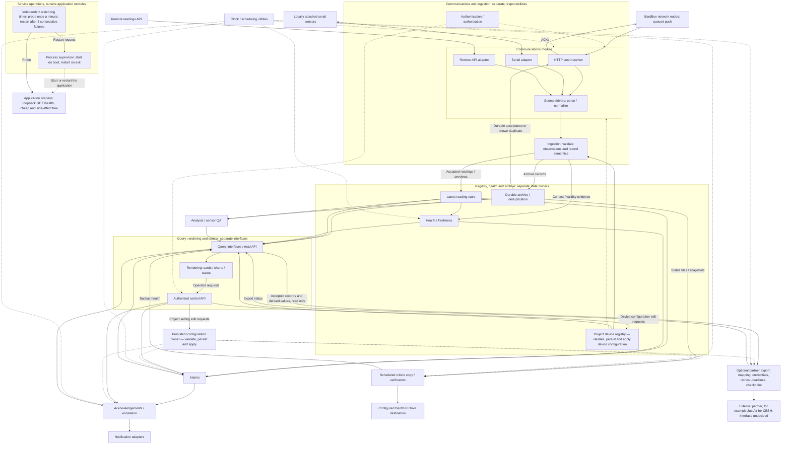
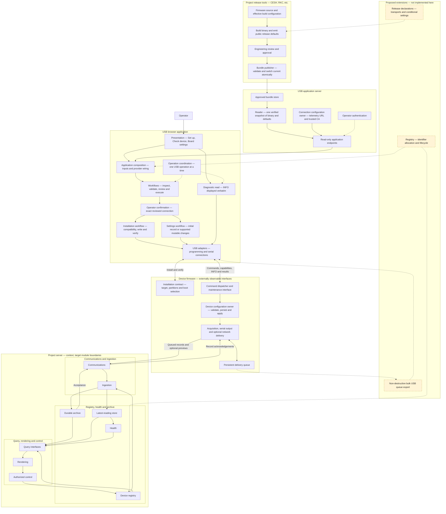

# BardBox Architecture Map

Status: **proposed target design**, recorded October 16, 2026 at Kornelis's request.
This is the single maintained source for all three diagrams below, not a claim
that their modules are implemented or deployed. Published contracts remain
authoritative. Review and merge are separate from implementation and deployment.

## Diagram index and ownership

| Diagram / contract | Maintained owner and source | Status |
| --- | --- | --- |
| Student-facing firmware template | [Node drawing below](#node-firmware-template) | Target design |
| Project server template | [Server drawing below](#project-server-template) | Target design |
| USB flasher implementation and external boundaries | [USB flasher drawing below](#usb-flasher) | Current implementation map with proposed extensions labelled |
| Firmware lifecycle, layouts and documentation map | [Firmware blueprint](firmware-blueprint.md) | Proposal |
| Student serial/base interface | [Serial/base API](firmware-base-and-serial-api.md) | Proposal; exact names and compatibility unresolved |
| Persistent delivery queue | [Buffer API](firmware-buffer-api.md) | Proposal |
| USB provisioning contract | [USB flashing and provisioning](usb-provisioning-standard.md) | Proposal |
| OTA lifecycle | [OTA lifecycle contract](ota-update-standard.md) | Optional contract; implementation and physical acceptance tracked separately |

All three diagrams are maintained in this BardBox document. Firmware Tools owns
its implementation code and links here; it does not maintain a second Mermaid copy.
The flasher diagram's abbreviated firmware/server context does not replace the
detailed target drawings or establish that the target is current implementation.
Historical branch copies remain provenance only. The original flasher block was
imported verbatim; the review correction aligns its server context with the
three explicit responsibility groups below.

## Node firmware template

Student code declares sensors/fields and submits complete measurements through
one BardBox communications interface. A sensor-level write operation is
illustrative: exact API names remain undecided. Acquisition, aggregation, record
publication, serial output and network upload have independent schedules.

Serial has no persistent delivery queue. It serves the latest sample with
identity, time and validity so repeated or old measurements are recognizable.
Normal output stays quiet until requested or streaming is enabled.

Network records persist before transmission and remain until acknowledgement.
A full queue is finite: overflow behavior and lost-record diagnostics require
an explicit reviewed policy; this drawing does not promise unlimited retention.
Submission does not imply immediate transmission on all adapters. Bounded
servicing/backpressure and record-creation errors must remain observable.
Optional live-preview delivery follows the [published optional contract](web-node-live-preview.md);
shared runtime extraction/adoption remains pending.
The node drawing shows only the durable baseline and does not claim a shared
preview sender is implemented. Previews never acknowledge queued archival records.
Network outages must not stop acquisition. Maintenance can pause acquisition
only under its separately reviewed lifecycle; no new reboot/power-cycle behavior
is introduced by this drawing.

The device carries provisioned identity and credentials. The server registry
owns registered definitions; writing a UID does not enroll or authenticate it.

## Project server template

**Packaging direction: Docker Compose template.** Modules describe responsibility,
not one container each. Include scheduled backup as a separate service; each
deployment configures credentials, destination and schedule. This is not evidence
that the existing template already packages these components or satisfies the
published service-recovery requirements.

Communications owns transport sessions, framing, deadlines and retries. Source
drivers normalize observations. Ingestion validates registered identity, channels
and record semantics independently of serial or network protocol details.
Authentication applies at every applicable external boundary; the schematic does
not imply only HTTP needs protection. Read/control authorization stays separate.

All BardBox network nodes push in the target. Direct serial sources and remote
API fetching are separate source types, not an alternative TCP-polling model for
BardBox network nodes. Wi-Fi/Ethernet are connectivity beneath HTTP, not peer
application protocols. The optional remote API example does not reinstate the
excluded QuantaQ/PurpleAir integrations.

Archive owns historical persistence/deduplication and its acceptance result.
Only that result can acknowledge an archive record; rejection, preview reception
or a fresh contact cannot dequeue it. Previews have their own non-archive response
semantics. Live publication must follow successful validation and relevant
acceptance; the parallel arrows express responsibilities, not an unsafe write order.

The [proposed ingestion contract](ingestion-contract.md) specifies the normalized
record/delivery interface, partial channel faults, envelope rejection, cadence
and Archive conflict/acceptance semantics. It refines these existing owners;
it does not establish implementation or migrate pilots. Firmware and USB
flasher maps retain their queue/ACK boundaries and need no arrow changes.

Registry owns device names, locations, latitude/longitude, link type and
per-device configuration. It validates, persists and applies edits through its
own interface; the control API passes edit requests, not prevalidated settings.
For example, longitude must be a finite number in [-180, 180] and latitude
in [-90, 90]. Queries obtain descriptive device metadata from Registry by UID.
The persistent configuration owner separately validates, persists and applies
project settings, such as backup policy and project cadence defaults. Invalid
edits leave stored and active configuration unchanged. Rendering may provide
early feedback; server owners enforce validation. These edits are not
sensor-ingestion input.

Latest state preserves measurement time separately from receipt/contact time.
Health can show a connected node delivering old records without calling those
measurements fresh. Registry definitions, latest state and historical archive are
different owners.

The rendering layer reads through query interfaces, not ingestion. Shared cards,
graphs, tables, identity and health components accept project-specific content.
Operator requests pass through authorized control interfaces; the browser owns
neither alarm timing nor safety decisions. Analysis has an explicit input interface
and must preserve project scientific definitions and source data.

Timer utilities provide clocks/deadlines. Alarm and escalation modules own their
policy and state. Notification providers execute delivery rather than deciding
alarm policy. Projects select optional capabilities and configure thresholds.

Backup runs periodically (for example hourly or daily) without blocking ingestion,
queries or rendering. Follow [service operations](service-operations-standard.md):
copy rather than destructive sync; lock runs; verify stable versions before
recording manifests; failed transfer/verification never advances deletion eligibility.
Retention deletes only explicitly eligible exact versions. Credentials stay local
and outside repositories/read APIs. Restore acceptance and retention configuration
remain deployment work. A container packaging choice does not waive process or
application-watchdog requirements.

**Optional partner export.** Outbound export to an external partner is optional.
It is distinct from incoming third-party collection (outside BardBox),
notifications and backup.
- **Read boundary:** it reads accepted records and derived values through the
  query and science read interfaces only. It has no ingestion or Archive ACK
  role and never changes history.
- **Ownership:** the export module owns its field mapping, partner credentials,
  retries, deadlines and checkpoint policy.
- **Example:** CESH's eventual JustAir export. Partner requirements are tracked
  in [cesh-air-monitor#35](https://github.com/bardphysicslab/cesh-air-monitor/issues/35).
- **Undecided (D10):** whether the partner pushes or pulls, the data subset,
  checkpoint and replay semantics, and credential issuance. No JustAir
  interface is assumed here.

**Service supervision and application watchdog.** These follow
[service operations](service-operations-standard.md).
- **Process supervision:** a supervisor starts the service on boot and
  restarts it whenever the process exits (for systemd, `Restart=always` and
  `RestartSec=5`).
- **Application watchdog:** an independent oneshot timer calls the loopback
  `GET /health` once a minute and restarts the application after three
  consecutive failures. A success resets the count.
- **`/health` stays cheap and side-effect free:** no sensor, database, file or
  network checks.
- **Scope:** this watchdog measures application responsiveness only. Sensor
  and node freshness belong to the Health module. Whole-host and power-loss
  recovery is a separate concern, not covered here (D11).
- **Docker Compose:** a restart policy restarts exited containers but does not
  detect a hung application, so packaging does not replace the independent
  watchdog.

Historical tool access remains the [authenticated read-only Data API/MCP boundary](data-api-mcp-boundary.md).
The dashboard control API is not an extension of that historical-data boundary.

### Server data inventory and module operations

**Status: proposed for review (October 16, 2026), not settled policy.** This is
an initial, category-level inventory of the data CESH and RKC collect or use. It
was checked against CESH `259cba6` and RKC `0c4f923`; categories found later are
added here.
- **Current implementation** describes those revisions. Its evidence is pinned in
  the companion [source evidence](server-data-inventory-evidence.md).
- **Target owner** follows the diagram above and the
  [ingestion contract](ingestion-contract.md).
- **Gap** entries are review observations, not decisions.

All measurements are one category, sensor data. Credentials are listed by
purpose and storage location only. Third-party comparison feeds (PurpleAir,
QuantAQ) and their API keys are outside BardBox and belong in separate
repositories ([bardbox#28](https://github.com/bardphysicslab/bardbox/issues/28);
see [required migration](#required-migration-and-limits)), so they are not
inventoried here. Science computed from BardBox measurements stays in scope. Module numbers refer to the
[server roadmap](https://github.com/bardphysicslab/bardbox-project-template/issues/31).

| # | Data category | Origin | Target owner | Projects | Current implementation | Gap for review |
| --- | --- | --- | --- | --- | --- | --- |
| 1 | Sensor data (all measurements) | Node sensors | Archive (history); Latest (current view) | Both | Current: CESH nodes push aggregates (stored in per-node daily CSV); RKC server polls nodes over TCP (interval CSV log) | Target for both: node-initiated queued push. RKC polling is a required migration, not a permanent design ([required migration](#required-migration-and-limits)). Per-channel faults and unknown time per contract; pruning owner (D3) |
| 2 | Derived science and QA results | Science module | Science (project-owned); storage undecided (D1) | CESH | Project-owned derived confidence and advisories computed from BardBox measurements, written into archive CSV rows | D1 |
| 3 | Device identity and bindings (UID, reported/legacy alias, archive device key; factory MAC deferred) | Provisioning; Registry | Registry | Both | UID lists in config files; firmware UID in NVS (CESH) or build (RKC) | Archive device key not implemented |
| 4 | Record identity, dedup and acceptance (record ID, source digest/profile, tombstones, rejection ledger, ACK outcome) | Node (ID); Communications (digest); Archive | Archive | CESH; RKC after push | CESH: ID-only check against an in-memory set rebuilt from CSVs. RKC: none (polling) | Content-aware durable dedup per contract |
| 5 | Times (measurement, receipt, observation, contact, acceptance, event) and clock quality | Node clock; server clock | Ingestion validates; Clock supplies server time | Both | CESH: device time with RTC/NTP flag; falls back to receipt time. RKC: server poll time | Receipt-time fallback removed; observation basis labelled |
| 6 | Firmware and protocol versions | Node | Archive (original record); Communications (supported list) | Both | CESH: in payload. RKC: optional cached INFO | Required original metadata per contract |
| 7 | Link and delivery diagnostics (RSSI, node queue counts, catch-up, errors, sensor-health counters) | Node | Archive (original record); Health (current delivery) | Both | CESH: payload fields, with `current_*` appended at send time. RKC: RSSI inside data | Split original from delivery diagnostics |
| 8 | Health and freshness projections (contact, stale/offline, `archive_blocked`) | Health | Health | Both | CESH: offline after three expected intervals. RKC: observation state per poll sweep | Backup scope (D4) |
| 9 | Cadence (reporting, acquisition, retry/catch-up, poll, logging) | Firmware; configuration | Registry (per device); configuration owner (project default) | Both | CESH: reported seconds, last value cached in memory. RKC: configured poll and log intervals | Millisecond precision and precedence per contract |
| 10 | Channel definitions, units and validity metadata | Project definitions | Registry | Both | Hard-coded per driver or node type | Registry-supplied definitions; archived snapshot (D5) |
| 11 | Registration and descriptive metadata (name, location, coordinates, owner, notes, enabled, legacy host/port) | Operators | Registry | Both | JSON app config; RKC admin edits written back to config | Backup scope (D4) |
| 12 | Alarm thresholds and alarm configuration (limits, delays, arm and door flags) | Operators | Alarm module | RKC | Per-node app-config fields, edited by admin and alert endpoints. The RKC CSV log reuses `min_temp_c`/`max_temp_c` for observed interval extremes | Kept distinct from ingestion validity limits; backup scope (D4) |
| 13 | Project configuration (titles, timezone, clock and freshness policy, poll/stale/offline, feature flags, retention, backup policy) | Operators | Persistent configuration owner | Both | JSON app config, environment overrides, backup env file | Backup scope (D4) |
| 14 | Display settings (visible fields, order, labels) | Project | Undecided (D2) | Both | Templates and code | D2 |
| 15 | Users, roles and sessions (operator identity — not device UID) | Operators | Authorization at the control and query boundaries | Both | RKC: one admin login from environment; no user IDs or roles. CESH: no dashboard login; machine bearer token for the historical Data API | Operator user/role model (D6) |
| 16 | Credentials (references only): device telemetry tokens, Data API token, admin login, SMTP, Twilio, rclone remote, device Wi-Fi/OTA secrets, partner export credentials (future) | Deployment; provisioning | Deployment secret storage outside source. Communications authenticates devices and Registry owns identity bindings (per the ingestion contract); issuance and lifecycle are separately owned ([firmware-tools#41](https://github.com/bardphysicslab/firmware-tools/issues/41)) | Both | Environment variables, local config, rclone config, device NVS | CESH firmware sends a device token the server does not check; issuance scheme and credential-to-identity integration contract (D7) |
| 17 | Contacts and availability (people, phone/email, order, availability, opt-outs) | Operators; inbound SMS | Escalation configuration; explicit owner open ([rkc-monitor#16](https://github.com/bardphysicslab/rkc-monitor/issues/16)) | RKC | App config, updated by the admin page and inbound STOP | D4, D8 |
| 18 | Alarm, escalation, acknowledgement and notification state (incidents, acknowledgement windows, processed inbound IDs, incident log, templates) | Alarm module; providers | Alarm and escalation modules | RKC | In-memory alert state; processed-ID JSON file; incident CSV copied by rclone | Restart durability; D4, D6 |
| 19 | Inbound messages and request logs (SMS replies, sender numbers, unknown-node attempts with remote IP) | External senders | Communications diagnostics; notification adapter | Both | CESH logs rejected-UID attempts. RKC parses SMS replies (webhook and poller) | Retention and privacy (D9) |
| 20 | Backup and recovery state (manifest, deferrals, lock, restore checkpoints) | Backup | Backup service, with Archive restore reconciliation | Both | CESH: rclone every 30 minutes, manifest, deferral file, lock, local retention deletion. RKC: incident-log copy only | No restore drill yet |
| 21 | Partner export configuration and state (field mapping, schedule, credential reference, checkpoint, delivery status and errors) | Operators; Export | Optional partner export module | CESH (future) | None | Interface, data subset, checkpoint and deadline policy (D10) |
| 22 | Service liveness and restart state (watchdog failure count, restart events) | Supervisor; watchdog | Service operations, outside application modules | Both | Watchdog service/timer units and scripts exist in both repositories; conformance not audited here | Separate from sensor freshness; whole-host recovery (D11) |

#### Proposed target: module operations by data category

The matrix shows the **proposed target design, not current behavior**.

| Mark | Meaning |
| --- | --- |
| C | Create |
| R | Read only. V, T, D and X each include reading the data. |
| V | Validate or verify |
| T | Transform or derive |
| S | Store as owner or durable copy |
| D | Display |
| X | Transmit to another module, a node or a provider. This includes ACKs and pass-through record envelopes. |
| Del | Delete |
| ? | Undecided; see decisions D1–D11 |
| — | No access in the proposed design |

Column 10 covers the authorized control API and the persistent configuration
owner. For data owned elsewhere it passes edit requests (X) to that owner, which
validates and stores them.

| # | Ingestion 01 | Registry 02 | Clock/startup 03 | Archive 04 | Communications 05 | Backup 06 | Latest/Health 07 | Query/Render 08 | Controls/config 10 | Science 11 | Alarms 12 | Serial 13 (optional, low) | Export (optional) |
| --- | --- | --- | --- | --- | --- | --- | --- | --- | --- | --- | --- | --- | --- |
| 1 Sensor data | V T | — | — | S Del ? | T X | X | S | D | — | R | R | C T X | T X |
| 2 Derived science | — | — | — | ? | — | ? | — | D | — | C T | ? | — | ? |
| 3 Device identity | V | C V S | — | S | V X | X | R | D | X | R | R | R X | T X |
| 4 Record ID, dedup, acceptance | V | — | — | C V S | C X | X | R | D | — | — | — | — | ? |
| 5 Times, clock quality | V T | — | C | S | C X | X | T | D | — | R | R C | C | T X |
| 6 Firmware/protocol | V | — | — | S | V X | X | S | D | — | — | — | X | — |
| 7 Link/delivery diagnostics | V T | — | — | S | T X | X | S | D | — | — | R | X | — |
| 8 Health projections | — | — | — | — | — | ? | C S | D | — | — | R | — | — |
| 9 Cadence | V T | V S | R | S | X | X | R | D | V S X | — | R | R | — |
| 10 Channel definitions | R | C V S | — | ? | R | ? | R | D | X | R | R | R | R |
| 11 Registration metadata | — | C V S | — | — | R | ? | — | D | X | — | R | R | ? |
| 12 Alarm thresholds | — | — | — | — | — | ? | — | D | X | — | V S | — | — |
| 13 Project configuration | R | — | R | R | R | R ? | R | D | C V S | R | R | R | R |
| 14 Display settings | — | — | — | — | — | ? | — | D | X ? | — | — | — | — |
| 15 Users, roles, sessions | — | — | — | — | — | — | — | V | V | — | ? | — | — |
| 16 Credentials | — | ? | — | — | V | R | — | V | V | — | R | — | R |
| 17 Contacts | — | — | — | — | — | ? | — | D | X | — | V S | — | — |
| 18 Alarm/notification state | — | — | — | — | — | X ? | — | D | X | — | C T S X Del | — | — |
| 19 Inbound messages/logs | — | — | — | — | C X | ? | — | ? | — | — | T | — | — |
| 20 Backup/recovery state | — | — | — | R | — | C S Del | R | D | — | — | — | — | — |
| 21 Partner export config/state | — | — | — | — | — | ? | — | D | X | — | — | — | C V S |
| 22 Service liveness/restart | — | — | — | — | — | — | — | — | — | — | — | — | — |

Notes:
- **Backup (06)** copies whole archived record envelopes, including device keys,
  original metadata, times, cadence and diagnostics. Restore reconciles archive,
  deduplication and identity-key state before accepting writes, as the ingestion
  contract requires.
- **Credentials (16)** are read or verified only at the boundary that uses them:
  device authentication in Communications, operator login in Controls,
  historical Data API access in Query, and provider credentials in Alarms and
  Backup. No module displays or returns secret values. Clock/startup has no
  credential access merely by sharing a process. Registry's "?" in row 16 is
  only about what credential-related data, if any, the integration contract
  (D7) places beside the identity bindings Registry already owns.
- **Serial (13)** is optional and low priority; neither CESH nor RKC needs it.
- **Partner export** (optional, no roadmap card yet) reads only through query
  and science read interfaces, never through ingestion or Archive acceptance,
  and changes no history.
- **Service liveness (22)** belongs to service operations outside the
  application modules; no module stores it, and `/health` reports
  responsiveness only.
- **Integration items** (the synthetic demo 09 and CESH/RKC adoption 14–15) own
  no data categories.

**Decisions needed (not settled here):**
- **D1** Storage and backup owner for derived science values.
- **D2** Display-configuration owner (validate and store).
- **D3** Archive pruning and retention owner. CESH's backup script deletes local
  readings today; the contract requires acceptance tombstones.
- **D4** Backup scope for registry data, configuration, thresholds, contacts,
  alarm state, health projections and request logs.
- **D5** Whether Archive keeps a channel-definition snapshot for later
  interpretation of records.
- **D6** Operator user and role model, and whether acknowledgements bind to an
  operator identity.
- **D7** Device credential issuance and lifecycle scheme, and the concrete
  contract linking a credential to its registered identity
  ([firmware-tools#41](https://github.com/bardphysicslab/firmware-tools/issues/41)).
  The existing owners are settled by the ingestion contract: Registry owns
  identity bindings and archive device keys, and Communications authenticates.
- **D8** Contacts configuration owner
  ([rkc-monitor#16](https://github.com/bardphysicslab/rkc-monitor/issues/16)).
- **D9** Retention and privacy rules for inbound messages and request logs.
- **D10** Partner export specifics: push or pull interface, data subset
  (including whether location or derived values are shared), checkpoint and
  replay semantics, deadlines, and partner credential issuance
  ([cesh-air-monitor#35](https://github.com/bardphysicslab/cesh-air-monitor/issues/35)).
- **D11** Whole-host and power-loss recovery (for example hardware watchdog or
  power protection), separate from the application watchdog.

**Per-module contract checklist** (fill in when a module's contract is written):
1. Data categories touched (its matrix column) and the owner of each.
2. Operations and invariants for each category.
3. State owned, persistence and backup scope.
4. Authorization boundary and credentials used.
5. Failure, retry and restore behaviour.
6. Open "?" decisions resolved, or explicitly deferred.
7. New categories found are added to this inventory.

## USB flasher

Diagram home: this BardBox Architecture Map. Implementation owner: Firmware Tools.
Imported from its reviewed-source candidate [2d036ed](https://github.com/bardphysicslab/firmware-tools/blob/2d036ed8918f73e4671d9ccdbdcd854e88faba28/docs/usb-flasher-architecture.md)
at Kornelis's request to centralize all three diagrams. That historical copy is
provenance only; future diagram changes are made here with the owning code change.

Implementation baseline: Firmware Tools `5142b97`, CESH firmware `34ff50a`
(0.11.0), release metadata emitter `259cba6`, and BardBox contract `f5a0cd6`.
The USB page and release-defaults bundle were deployed on 2026-10-16; delivery
and physical evidence live in [the authoritative tracker](https://github.com/bardphysicslab/firmware-tools/issues/5).
The diagram describes responsibilities, not a claim that every firmware/server
module has already been extracted into a shared library.

### Layers

### Boundary contracts

| Owner | Inputs, outputs and preserved responsibility |
| --- | --- |
| Project build/release tools | Produce firmware and public defaults from the named source commit and effective build configuration. Compiled defaults and approved operator proposals retain distinct provenance. A metadata-only release may reuse an existing exact binary; this is not a rebuild. |
| Publisher and bundle reader | Approval covers exact input digests, including optional release metadata. The reader serves one verified snapshot; an operation must not mix release versions. Existing bundles without metadata remain readable. |
| USB host configuration | Currently supplies telemetry URL and public trusted CA. These are not sensor properties or per-device registration credentials. Release-owned form defaults do not silently come from host defaults. |
| Browser presentation and workflows | One Board settings form prefills from the approved release. Save selects/reads a board, validates the whole plan and offers one review. Confirmation covers that connected target only. Workflows enforce sequencing and stop after failed or uncertain steps, reporting partial results; multiple writes are not claimed atomic. |
| Firmware installation interface | Target/layout compatibility, boot selection and startup confirmation are separate from internal sensor/application structure. Valid matching-layout updates preserve configuration and queued data. Recovery has separate explicit data-loss confirmation. |
| Firmware configuration/maintenance | Firmware validates commands, owns persistence and reports capabilities/limits. Initial identity/server records remain immutable through this workflow; supported Wi-Fi and interval changes use separate mutable settings. Interval changes require restart. INFO remains a raw diagnostic reply. |
| Network node and project server | The node communicates directly with its destination after setup. The flasher is not a readings relay. A preview does not dequeue a record; queued records remain until durable server acceptance or known duplicate. Server history ordering and rendering belong to the server. |

### Current limits and proposed evolution

- Today: one current approved CESH TEST bundle, Wi-Fi-oriented provisioning,
  manually entered established identifiers, and no release selector in assembly.
- Proposed: release-declared transports and conditional settings, allowing a
  serial-only node without mandatory Wi-Fi/endpoint/CA fields. Firmware internals
  and student-facing publish API may evolve without changing USB clients when
  external contracts remain compatible. LoRa support is not implemented.
- Proposed registry integration is optional and uses explicit service interfaces;
  writing an identifier to a board does not register it with a receiving server.
  An identifier is not an authentication credential. Credential issuance remains
  a separate unresolved contract.
- Planned bulk queue export is read-only and non-destructive, not a serial delivery
  queue. Overflow-policy changes remain separate deferred firmware work.
- OTA engineering is a separate application/workflow. It may share bundle validation
  and approval components; it owns assignments, authenticated network delivery,
  health validation and rollback. Neither app requires the other to be running.

Shared format definitions remain in [BardBox USB device configuration and selection](https://github.com/bardphysicslab/bardbox/blob/main/docs/usb-device-configuration-standard.md).
This implementation map does not replace those contracts, the project firmware
blueprint or the separately proposed server template architecture.

## Required migration and limits

- RKC server-initiated TCP polling must be replaced with node-initiated push.
  It is pending migration work, not a permanent option in this target.
- Remove QuantaQ and PurpleAir integrations from CESH and exclude both from
  the template. These removals are planned, not completed by these documents.
- Extract reusable capabilities incrementally. CESH's queue is a concrete first
  candidate; preserve queue format/ACK behavior and fault evidence. This is a
  recommendation, not implementation authorization.
- Existing project sources can differ from these targets. The earlier print PDF
  is a discussion snapshot and predates rendering, backup and push-only refinements.
- Registry synchronization, full-buffer policy, status/schema compatibility,
  sensor/channel partial validity, independent consumers, hardware queue survival,
  and flasher/OTA lifecycle acceptance remain explicit review/adoption work.
- Applicable [Bard web policy and service guidance](https://github.com/bardphysicslab/engineering-standards/blob/main/docs/bard-it/README.md)
  remains separate authority. No provider, hosting or institutional compliance
  determination is made here.

## Keeping work aligned

Use the phrase **Check against the BardBox Architecture Map** in task prompts.

Before firmware, server, USB or OTA changes:
1. Read this map and the applicable linked contract/implementation diagram.
2. Resolve and record the governing BardBox main revision; record exact pending
   proposal and consumer revisions separately. A diagram branch is not adopted policy.
3. Name the affected operations, data/state owners, permissions, failure behavior
   and compatibility/versioning consequences.
4. Update the relevant diagram in this document and its linked contract when
   changing a boundary. Check the other two diagrams for consistency and record
   the result. Do not silently implement a draft or copy Mermaid into consumers.
5. In the PR, record the revision checked, conformance or deliberate gaps, affected
   consumers, and relevant tests/evidence. Review those claims before merge.

BardBox owns shared contracts and the single source for all three architecture
diagrams. Firmware Tools owns flasher implementation and links here. Its repository
instructions require this entry point alongside applicable main standards. Links
and checklists improve traceability; they cannot guarantee understanding or prove
runtime conformance. Automated link/evidence checks may supplement independent
semantic review; no new CI enforcement is installed by this documentation update.

Decision: keep all three diagrams physically in BardBox, in this one document.
The earlier proposal of a distributed index was rejected by Kornelis because he
wants one place to edit the overall design and compare related diagrams. Consumers
link here; their code, acceptance evidence and detailed operating docs remain in
their own repositories. Exact source revisions preserve provenance.

## Evidence and provenance

October 16 review reconciliation checked current BardBox main `f5a0cd6`,
[USB configuration/selection](usb-device-configuration-standard.md), CESH `34ff50a`
and Firmware Tools `5142b97`. These source facts supplement the task's retained
governing commit below; they do not silently switch its policy baseline.
The server and flasher context now share three responsibility groups. Runtime
state does not become one combined owner merely because it shares a visual group.

Direction: [original communications North Star](https://github.com/bardphysicslab/bardbox/issues/31#issuecomment-6190826224),
[functional drawings](https://github.com/bardphysicslab/bardbox/issues/31#issuecomment-6220370776),
[required migration clarification](https://github.com/bardphysicslab/bardbox/issues/31#issuecomment-6224357842),
and [flasher cross-link handoff](https://github.com/bardphysicslab/bardbox/pull/32#issuecomment-6224677892).
The subsequent October 16 conversation added communications/ingestion separation,
rendering, configurable scheduled backup and this central entry point.

Shared guidance: bardphysicslab/engineering-standards@341b3ba82503eb23b786dfcf71af430cc627e2a5
BardBox standards: bardphysicslab/bardbox@143d42976fd224e8609ee90744ba490a91df1819

Existing earlier records retain their own governing commits. This proposal adds no
runtime implementation, template code, firmware change, skill change, migration,
merge, deployment or physical acceptance. It must be reviewed at its exact commit.
